# hello-pear-electron <a name="hello-pear-electron"></a>

> Pear Hello World for Electron with `pear-runtime`

End-to-end boilerplate for embedding [pear-runtime][pear-runtime] into [Electron][electron] apps and deploying peer-to-peer application updates.

- Peer-to-Peer Over-the-Air updates with update-restart
- Embedded [bare][bare] runtime workers
- Application storage management
- Staged deployment pipeline with multisig production releases

## Table of Contents

- [OS Support](#os-support)
- [Requirements](#requirements)
- [Terminology](#terminology)
- [Development](#development)
  - [Install](#install)
  - [Start](#start)
- [Architecture](#architecture)
  - [How the apps talk to each other](#apps-overview)
  - [Updates](#updates)
    - [OTA update diagrams](#ota-diagrams)
  - [Storage](#storage)
  - [Workers](#workers)
- [Peer-to-Peer Deployments](#deployments)
- [CI Configuration](#ci-configuration)
- [Store Submissions](#store-submissions)
  - [Flathub](#flathub)
  - [Snap](#snap)
- [Scripts](#scripts)
- [Developer FAQ](#faq)
- [Troubleshooting](#troubleshooting)

## OS Support <a name="os-support"></a>

- macOS
- Linux
- Windows

## Requirements <a name="requirements"></a>

- `npm` via [Node.js][nodejs]
- [`pear`][pear-docs] - `npx pear`

## Terminology <a name="terminology"></a>

- **OTA** - Over-the-Air. Data delivery without manual intervention
- **OTA Updates** - Direct software updates to running applications without manual reinstallation
- **P2P** - Peer-to-Peer. Direct point-to-point communication between machines/devices without central servers
- **application drive** - the [Hyperdrive][hyperdrive] behind a Pear application
- **deployment folder** - the build directory output by `pear build` which is then staged
- **multisig** - a co-signing protocol requiring a quorum of signers before writes can be committed. This cryptographically binds project integrity to collective sign-off
- **pear link** - a [link format][pear-link-format] for addressing peer-to-peer applications
- **quorum** - the minimum number of signers needed to commit a multisig write
- **release lines** - parallel deployment streams at different stability levels
- **seeding** - exposing a drive to peers for discovery and download
- **vendor signing** - signing distributables with OS-level certificates so they run on other machines without quarantine e.g. Apple notarization, Windows code signing
- **versioned link** - a pear link of the form `pear://<fork>.<length>.<key>` where fork, length and key correspond to [core.fork][hypercore-fork], [core.length][hypercore-length], and [core.key][hypercore-key] of the [Hypercore][hypercore] behind the [Hyperdrive][hyperdrive] behind the Pear application

## Development <a name="development"></a>

### Install <a name="install"></a>

On Windows and Linux:

```sh
npm run install:all
```

On macOS:

```sh
npm run install:mac
```

### Start <a name="start"></a>

Start app in development mode:

```sh
npm start
```

When running locally, updates are turned off to avoid the built application being swapped from local development when there is an update.

To enable updates for testing update flow in local development use

```sh
npm start -- --updates
```

## Architecture

The application architecture is tightly scoped to handling P2P OTA Updates, running embedded [Bare][bare] workers and facilitating [Peer-to-Peer Deployment](#deployments) flows.

### How the apps talk to each other <a name="apps-overview"></a>

OpenCollab ships three clients — the Electron desktop app, the iOS app and the
`opencollab` CLI — and none of them talks to a server. Each runs the **same Bare
backend** (`workers/main.js`); the UI only sends commands to it and renders what it
reports. The backends find each other on Hyperswarm and replicate the board directly.

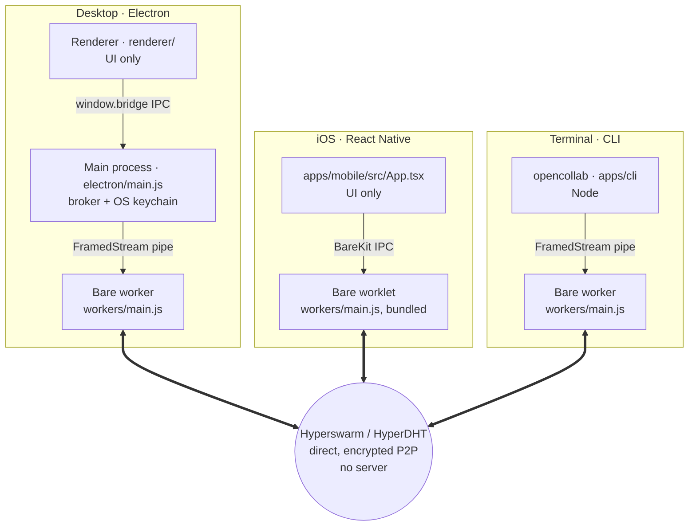

All three pipes carry the same JSON messages (`room:start`, `board:create`,
`board:comment`, `board-state`, `peer-count`, …; names in
`packages/board-protocol`), plus the plain strings `updating` / `updated` for OTA.

**Inside every worker** a board is one Corestore with an Autobee and one image store per
member:

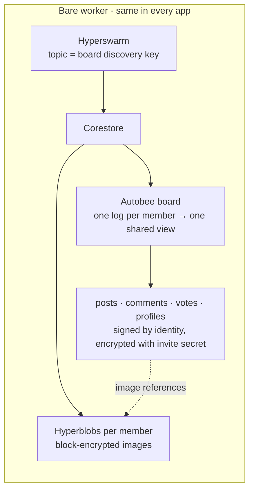

**A comment from the iPhone** reaches the other apps like this:

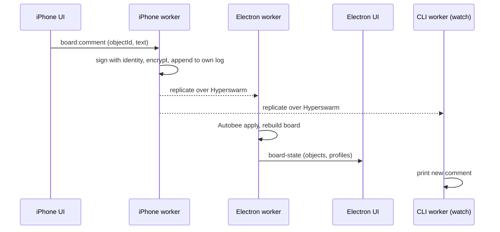

**Joining a board** needs any existing member online once; until then the newcomer
waits and cannot write:

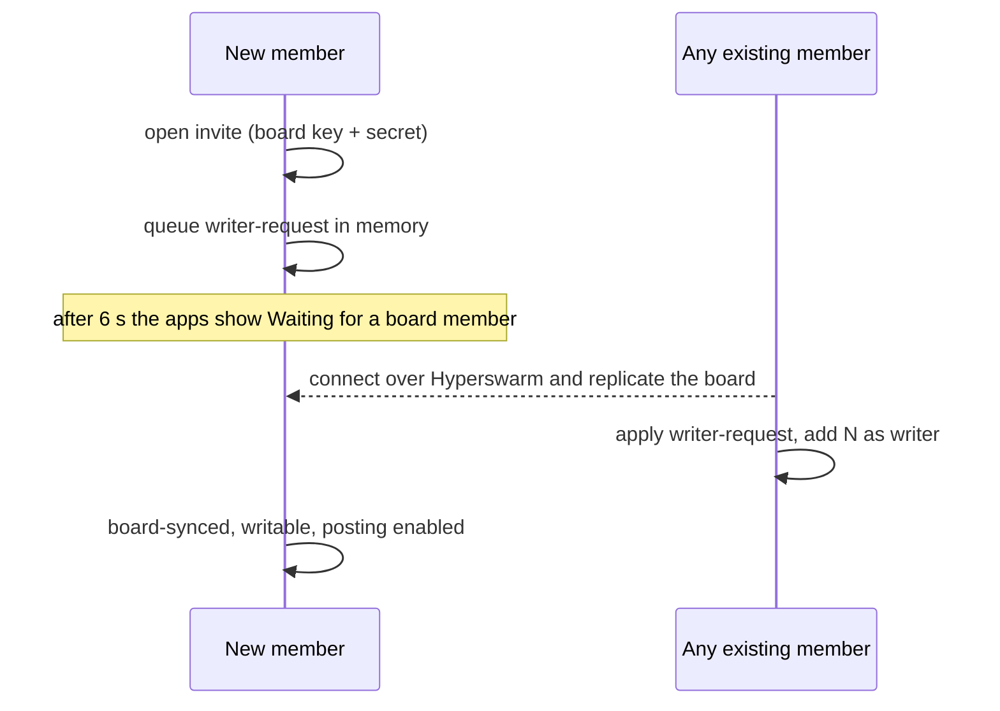

**Releases** travel the same way. Each client follows its own `upgrade` link, and an
always-on `pear seed` serves them:

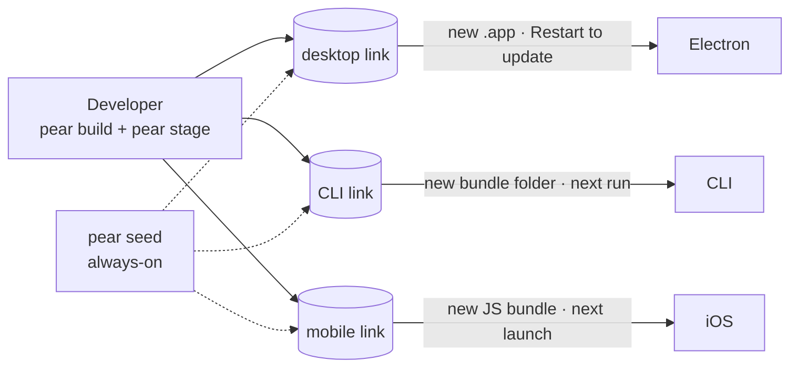

### Updates <a name="updates"></a>

An update occurs when a seeded application drive is written to.

When an update occurs, the instance will emit two events `updating` and `updated`.

```js
pear.updater.on('updating', () => {
  // update view to indicate updating in progress
})
```

```js
pear.updater.on('updated', () => {
  // update view to indicate application updated
})
```

#### Disabling Updates <a name="disabling-updates"></a>

Pass `--no-updates` flag to disable updates per application run.

To disable updates as an application default, ensure that the package.json is spread into the options (`{...pkg, ...}`) and set the `updates` field to `false`:

```json
{
  "version": "1.0.0",
  "updates": false
  ...
}
```

#### Runtime Update Flow <a name="runtime-update-flow"></a>

A running application checks for updates on startup and when its application drive receives new data. After the first 60 seconds of startup, detected updates are scheduled with a randomized delay of up to 1 hour by default to spread update traffic across peers. This can be configured with the updater's `delay` option.

A running application will receive `updating` and `updated` events from the updater in
the Bare worker, which forwards them as plain strings over the worker IPC pipe. The
renderer (`renderer/app.js`) shows an update banner; **Restart to update** calls
`bridge.applyUpdate()`, which swaps the current application path with the updated build
and removes the old one, then `bridge.appAfterUpdate()` relaunches into the new version.

#### OTA update diagrams <a name="ota-diagrams"></a>

All three OpenCollab clients update peer-to-peer from their own `upgrade` link, and in
every one the updater runs **inside the Bare worker** (`pear-runtime` on desktop and the
CLI, `pear-mobile` on iOS). Releasing is the same for all of them:

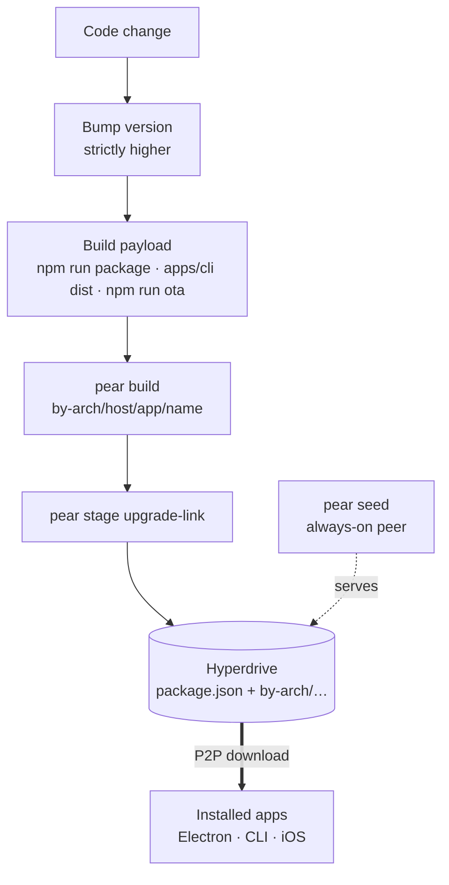

**When does a running app notice a release?**

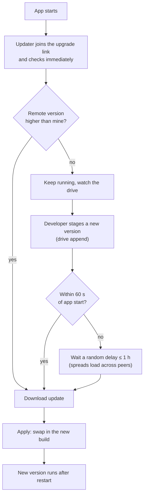

**Desktop (Electron)** swaps the whole `.app` / AppImage / MSIX:

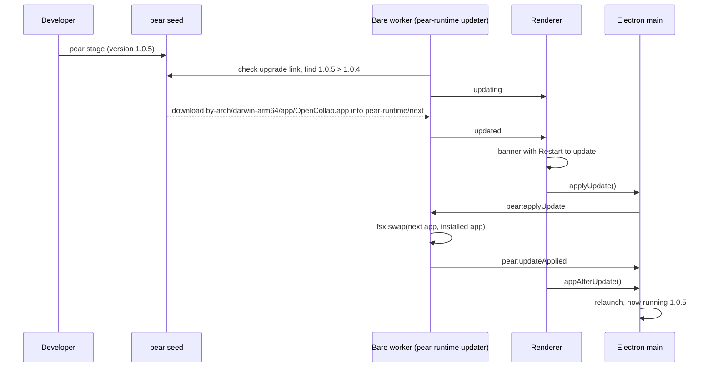

**iOS** can only replace JavaScript (UI + the embedded worker); native code needs a new
binary. The downloaded bundle is booted on the next launch by `pear-runtime-react-native`
boot control in `AppDelegate.swift`:

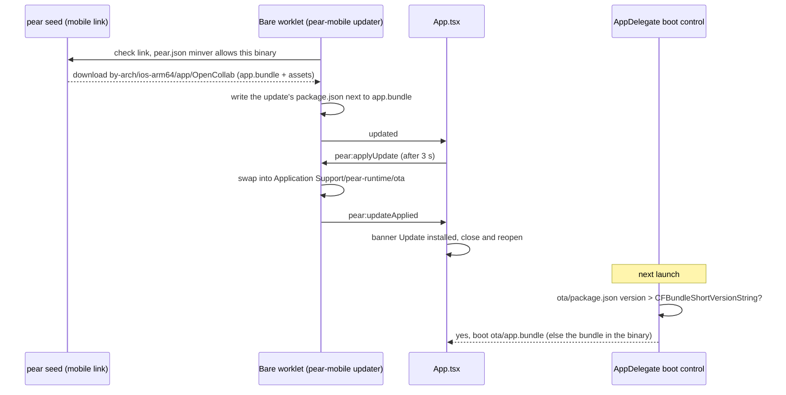

**CLI** swaps its install folder and runs the new version on the next command:

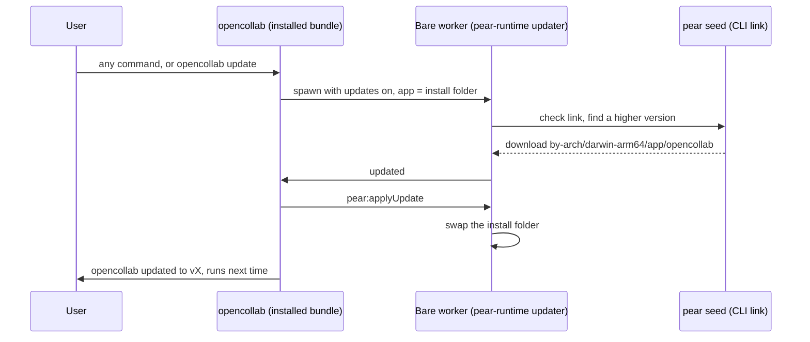

| Client   | Upgrade link | Payload                               | Takes effect                   |
| -------- | ------------ | ------------------------------------- | ------------------------------ |
| Electron | desktop      | whole app (`.app`, AppImage, MSIX)    | after **Restart to update**    |
| CLI      | CLI          | bundle folder (code + worker + deps)  | next command                   |
| iOS      | mobile       | Hermes JS bundle + assets (no native) | next launch (close and reopen) |

### Storage <a name="storage"></a>

A storage dir is used for persistence of peer-to-peer/local data. In development this defaults to `<tmpdir>/pear/<name>`.

In Production this is per OS:

- Mac: `~/Library/Application Support/<name>`
- Linux: `~/.config/<name>`
- Windows: `%USERPROFILE%\AppData\Local\<name>`

The `dir` option defines where peer-to-peer storage should be kept.

The `pear.storage` property holds a path to application storage, this value should be passed as to [`Corestore`][corestore] as its `storage` argument.

The `--storage` flag can be passed to use custom storage for multiple running instances. This allows for local end-to-end peer-to-peer flow.

In development custom storage can be passed as so:

```sh
npm start -- --storage /tmp/custom/storage
```

#### Setting Storage for Additional Instances <a name="additional-instances"></a>

The storage dir holds a [`Corestore`][corestore] and may hold application corestores. Running an application with a different storage location means using a separate `Corestore`, just like an app running on another machine would be using a separate `Corestore`.

An additional application instance can be run with the following (per OS).

##### macOS <a name="additional-instances-macos"></a>

```sh
open -n <name>.app --args --storage /tmp/custom/storage
```

##### Linux <a name="additional-instances-linux"></a>

```sh
./<name>.AppImage --storage /tmp/custom/storage
```

##### Windows <a name="additional-instances-windows"></a>

```sh
.\<name>.exe --storage C:\tmp\custom\storage
```

### Workers <a name="workers"></a>

The idea is to put application peer-to-peer code into a main worker that then acts as a local backend for the application view layer.

```js
const IPC = pear.run('./workers/main.js', [pear.storage])
IPC.on('data', (data) => {
  console.log('data from worker', data)
})
IPC.write('hello')
```

The `workers/main.js` would then be executed with an embedded Bare runtime.

The other side of the IPC stream can be accessed inside the worker as `Bare.IPC`.

Note how `pear.storage` is passed in as the first argument, this can be accessed via `Bare.argv[2]`.

```js
const Corestore = require('corestore')
const storage = Bare.argv[2]

Bare.IPC.on('data', (data) => console.log(data.toString()))

Bare.IPC.write('Hello from worker')

const corestore = new Corestore(storage)
//.. do more with corestore..
```

## Peer-to-Peer Deployments <a name="deployments"></a>

Use the [`pear`][pear-docs] CLI to deploy applications.

The full release flow — stage, provision, and multisig — plus the Foundational Steps, release lines, and per-OS build/signing details now live in the Pear docs:

- [Deploy your application](https://docs.pears.com/how-to/operate-an-app/manual-deployment/deployment) — the eight Foundational Steps, command by command
- [Release pipeline](https://docs.pears.com/explanation/deployment-releasing-apps-p2p) — why stage, provision, and multisig exist and how they chain together
- [Build desktop distributables](https://docs.pears.com/how-to/operate-an-app/build-and-package/build-desktop-distributables) — macOS, Windows, and Linux signing and notarization

The Foundational Steps bootstrap the deployment and then feed into the repeating release cycle:

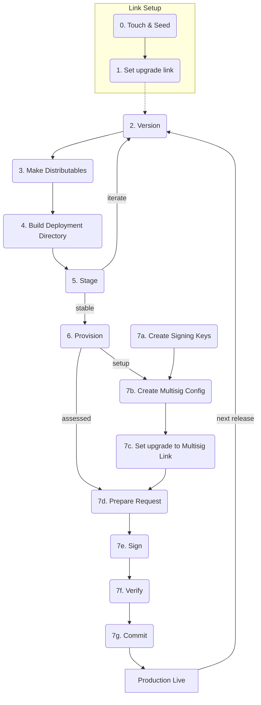

## CI Configuration <a name="ci-configuration"></a>

Create a GitHub environment (Settings -> Environments) named `release`. Run the `Build Release` workflow to build in CI. This workflow requires these secrets for signed builds:

| Secret                    | Platform | Notes                                                       |
| ------------------------- | -------- | ----------------------------------------------------------- |
| `CERTIFICATE_P12`         | `darwin` | Base64 export of Developer ID Application `.p12`            |
| `CERTIFICATE_PASSWORD`    | `darwin` | Password used to export the `.p12`                          |
| `MAC_CODESIGN_IDENTITY`   | `darwin` | e.g. `Developer ID Application: Name (TEAMID)`              |
| `APPLE_ID`                | `darwin` | Apple Developer account email                               |
| `APPLE_PASSWORD`          | `darwin` | App-specific password (not the account password)            |
| `APPLE_TEAM_ID`           | `darwin` | Membership details at <https://developer.apple.com/account> |
| `WINDOWS_CERT_PFX_BASE64` | `win32`  | Base64 export of Windows `.pfx`                             |
| `WINDOWS_CERT_PASSWORD`   | `win32`  | Password for the Windows `.pfx`                             |

- macOS signing requires an [Apple Developer Program](https://developer.apple.com) membership.
- Windows certificate 'subject' must match the `Publisher` in [AppxManifest.xml](build/AppxManifest.xml).
- Linux builds are not signed, no configuration needed.

## Store Submissions <a name="store-submissions"></a>

Applications built from this template can also be distributed through platform-specific application stores.

### Flathub <a name="flathub"></a>

Flathub packages applications as Flatpaks. This section covers preparing a Flatpak manifest and submitting releases for review.

Fork the [flathub repository](https://github.com/flathub/flathub) in your GitHub organization, clone it and create a branch targeting the `new-pr` branch of the repository:

```sh
$ git clone git@github.com:<org>/flathub.git
$ cd flathub
$ git checkout -b my-app-submission -t new-pr
```

Create these files in the flathub directory:

- metainfo file using the [appstream web form](https://www.freedesktop.org/software/appstream/metainfocreator/#/), like [`com.pears.HelloPear.metainfo.xml`](./flatpak/com.pears.HelloPear.metainfo.xml)
- Flatpak YAML file, like [`com.pears.HelloPear.yml`](flatpak/com.pears.HelloPear.yml)

#### Testing

Install the Flatpak tools:

```sh
$ sudo apt install flatpak
$ flatpak remote-add --if-not-exists --user flathub https://dl.flathub.org/repo/flathub.flatpakrepo
$ flatpak install flathub org.flatpak.Builder
```

In the project directory, [build](https://docs.pears.com/how-to/operate-an-app/build-and-package/build-desktop-distributables#linux) the app and serve the generated Flatpak artifacts over HTTP:

```sh
$ python3 -m http.server --directory out/make/
```

In the `flatpak` directory, build and install the Flatpak:

```sh
$ flatpak run --command=flathub-build org.flatpak.Builder --disable-rofiles-fuse com.pears.HelloPear.yml
$ flatpak install --user ./repo com.pears.HelloPear
```

Repeat the build command after making any changes to the manifest.

Launch the application from your desktop environment or run it from the CLI:

```sh
$ flatpak run com.pears.HelloPear
```

Uninstall using:

```sh
$ flatpak uninstall com.pears.HelloPear
$ rm -rf ~/.var/app/com.pears.HelloPear
```

If the builds take up too much memory, clear these build files from the `flatpak` directory:

```sh
$ rm -rf builddir repo .flatpak-builder
```

After confirming that the Flatpak works:

- Upload the Flatpak artifacts to a publicly accessible location with versioned URLs like [this site](https://static.keet.io/downloads/) and update the artifact links in the Flatpak YAML.
- For verification, upload an empty file to your app website `https://<app-website>/.well-known/org.flathub.VerifiedApps.txt`.
- Open a PR on the [flathub repository](https://github.com/flathub/flathub) from your branch for submission, like [this PR](https://github.com/flathub/flathub/pull/8716).
- Address all the review comments.
- Comment `bot, build` to test building the Flatpak on the Flathub CI.
- Once the submission is accepted, the Flathub maintainers create a repository in the flathub organization with the changes from the submission branch, like [this repository](https://github.com/flathub/io.keet.Keet).
- Log in to the [Flathub Developer Portal](https://flathub.org/en/developer-portal) to manage the app and complete the verification by copying the token from this page to the app website `https://<app-website>/.well-known/org.flathub.VerifiedApps.txt`.
- In a few hours, the app should be available on Flathub, like [this app](https://flathub.org/en/apps/io.keet.Keet).

If the app doesn't show up on Flathub:

- If the Flathub bot opens an issue on the repository containing build errors, address it.
- If it's unrelated, comment `bot, retry` or open an issue in [Flathub](https://github.com/flathub/flathub/issues) for assistance from the maintainers.
- Follow the build status at <https://builds.flathub.org>. App-specific build status is available at `https://builds.flathub.org/status/<app-id>`.

To automate the Flathub bot to open PRs when new versions of the app are available on the website, follow [this guide](https://github.com/flathub-infra/flatpak-external-data-checker/#changes-to-flatpak-manifests) and set up the external data checker on the `type: archive` source like this depending on the format of the app site contents:

```yml
x-checker-data:
  type: html
  url: https://static.keet.io/downloads/
  version-pattern: href="((?:\d+\.)+\d+)/"
  url-template: https://static.keet.io/downloads/$version/Keet-arm64-flatpak.tar.gz
```

### Snap <a name="snap"></a>

Snap packages applications for Linux and distributes them through the Snap Store. This section covers preparing a Snap package, testing it locally and publishing releases to the Snap Store.

Install the Snap tools:

```sh
$ snap install snapcraft --classic
$ snap install lxd
$ sudo usermod -a -G lxd $USER
$ sudo lxd init --auto
```

In the project directory, [build](https://docs.pears.com/how-to/operate-an-app/build-and-package/build-desktop-distributables#linux) the app. This will create a `.snap` package in the `out/make` directory.

Install the Snap:

```sh
$ snap install out/make/hellopear_1.0.0_arm64.snap --devmode
```

After making changes to the Snap configuration, rebuild the application and reinstall the generated Snap.

Launch the application from your desktop environment or run it from the CLI:

```sh
$ hellopear
```

Uninstall using:

```sh
$ snap remove hellopear
```

If the builds take up too much memory, clean the build container:

```sh
$ cd out
$ snapcraft clean
```

Refer to the [Electron Forge Snap Maker documentation](https://github.com/holepunchto/electron-forge-maker-snap) to configure the Snap.

After confirming that the Snap works:

- Create your developer account in <https://login.ubuntu.com/> and log in.
- Log in from your terminal with `snapcraft login`.
- Register your Snap using [the name](https://documentation.ubuntu.com/snapcraft/9.0/how-to/publishing/register-a-snap/#name-your-snap) with `snapcraft register <snap-name>` or `snapcraft register --private <snap-name>` for a private Snap.
- Publish your Snap with `snapcraft upload --release=stable <my-snap>.snap`.
- Check the release status with `snapcraft status <snap-name>`.

Snapcraft will guide you with the next steps if release fails.

Once the Snap has been released, it should be available on the Snap Store `https://snapcraft.io/<snap-name>`:

```sh
$ snap install <snap-name>
$ <snap-name>
```

To automate Snap releases, first create this credentials file:

```sh
$ snapcraft export-login <credentials-filename>
```

Set the contents of the file as a secret in your automation pipeline and authenticate Snap with:

```sh
$ export SNAPCRAFT_STORE_CREDENTIALS=$(cat <credentials-filename>)
```

Upload a new Snap release to the desired channel (for example, `stable`):

```sh
$ snapcraft upload <snap-name>.snap --release stable
```

## Scripts <a name="scripts"></a>

### `npm start` <a name="script-start"></a>

Start app in development mode.

```sh
npm start
```

Uses: `electron-forge start -- --no-updates`

---

### `npm run lint` <a name="script-lint"></a>

Check formatting and linting.

```sh
npm run lint
```

Runs:

- `prettier --check .`
- `lunte`

---

### `npm run format` <a name="script-format"></a>

Auto-format and fix lint issues.

```sh
npm run format
```

Runs:

- `prettier --write .`
- `lunte --fix`

---

### `npm run package` <a name="script-package"></a>

Package app without creating distributables.

```sh
npm run package
```

Runs: `electron-forge package`

---

### `npm run make` <a name="script-make-linux"></a>

Create distributables.

```sh
npm run make
```

Runs: `electron-forge make`

---

## Developer FAQ <a name="faq"></a>

Ten questions developers most often ask when they meet this stack, answered for this
repo.

### 1. What are Holepunch, Pear, Bare and Hyperswarm, and how do they fit together?

Holepunch builds the peer-to-peer stack; the pieces are layers:

- **Bare** — a small, embeddable JavaScript runtime (think minimal Node.js) that also
  runs inside iOS/Android apps via BareKit.
- **Hyperswarm / HyperDHT** — finds peers for a topic and opens encrypted connections
  between them, hole-punching through NATs.
- **Hypercore, Corestore, Hyperbee, Hyperdrive, Hyperblobs, Autobase/Autobee** — data
  structures: signed append-only logs, a store of many logs, a key-value B-tree, a file
  system, a blob store and a multi-writer database built on top.
- **Pear** — the application layer: the `pear` CLI (touch, stage, seed, provision,
  multisig, install) and `pear-runtime` / `pear-mobile`, which embed P2P OTA updates
  into Electron and React Native apps.

### 2. Why does the backend run in a Bare worker instead of Electron's main process?

So the same code runs everywhere. `workers/main.js` is the whole P2P backend (swarm,
storage, encryption, updates). Electron's main process only spawns it and relays
messages; the mobile app runs the same file bundled with `bare-pack`; the CLI
(`apps/cli`) spawns it from plain Node. The UI never touches the network directly.

### 3. How do peers find each other without a server?

Every board has a 32-byte key; peers join Hyperswarm on its **discovery key** (a hash of
the key) and the DHT introduces them. Connections are direct and Noise-encrypted. When
both sides are behind restrictive NATs (`natType: "Random"`, common on some mobile
carriers) hole-punching fails; a relay or an always-on peer with a public address
solves it (`pear blind-relay`, `pear seed`, `opencollab watch` on a server).

### 4. Where does the data live, and how do several writers stay in sync?

On each device. A Corestore in the app's storage directory holds Hypercores; the board
is an **Autobee**: every member appends to their own log and a deterministic `apply`
function merges all logs into one shared Hyperbee view. Readers only download what they
need (sparse replication), which is how images load on demand.

### 5. Is the data private?

Connections are encrypted, and a core can only be replicated by someone who knows its
key. On top of that this app encrypts board operations with the invite secret and image
blobs with a key derived from it, so even a peer that stores the data cannot read it.
Anyone who ever held an invite can read the board, and append-only logs cannot take
data back from peers that already have it.

### 6. What happens when nobody is online?

Nothing syncs. There is no server holding a copy: data and app updates are served by
peers. Keep at least one always-on peer — `pear seed <link>` for app releases, or a
long-running board member such as `opencollab watch` — and changes made offline sync
the next time two peers meet.

### 7. What is a `pear://` link and how do users install the app?

It addresses a Hyperdrive. `pear touch` creates one, `pear stage` writes a
`pear build` deployment folder to it, `pear seed` serves it, and users run
`pear install pear://<key>`. A versioned link (`pear://<fork>.<length>.<key>`) pins an
exact state. Production releases go through `pear provision` and `pear multisig` (see
[Peer-to-Peer Deployments](#deployments)).

### 8. How do OTA updates work, and why didn't my app update?

The updater in the worker watches the `upgrade` link. Every launch checks immediately;
releases staged within 60 s of launch are picked up at once, later ones after a random
delay of up to an hour. Only a strictly higher `version` updates — there is no
downgrade, so a rollback is re-staged under a higher version. The usual reasons nothing
arrives: the version was not bumped, nothing is seeding, the seeder is unreachable, or
the worker never started (see question 10).

### 9. Can mobile apps update without an App Store release?

Partly. `pear-mobile` downloads a newer JavaScript bundle (UI and worker) and
`pear-runtime-react-native` boots it in Release builds when its version is newer than
the binary's. Anything native — new modules, permissions, Pods, React Native upgrades —
still needs a new binary. Debug builds always load from Metro.

### 10. Why does the packaged app's worker crash with `MODULE_NOT_FOUND` when `npm start` works?

Bare resolves modules differently from Node and from dev. Common causes:

- Node builtins: Bare has none, so worker code needs an `imports` map
  (e.g. `{"events": {"bare": "bare-events", "default": "events"}}`).
- Packages the worker imports but `package.json` does not declare (e.g. workspace
  packages) are pruned from the package.
- Testing from `out/` inside the repo hides both problems, because Bare walks up into
  the repo's `node_modules`. Verify a packaged build from a copy outside the repo.

## Troubleshooting <a name="troubleshooting"></a>

### App did not update <a name="app-did-not-update"></a>

#### Was the version updated? <a name="check-version-updated"></a>

See [2. Version](https://docs.pears.com/how-to/operate-an-app/manual-deployment/deployment#2-version)

#### Is the upgrade link correct? <a name="check-upgrade-link"></a>

[1. Set upgrade link](https://docs.pears.com/how-to/operate-an-app/manual-deployment/deployment#1-set-the-upgrade-link)

#### Is the app seeded? <a name="check-app-seeded"></a>

The upgrade link must be seeded:

```sh
pear seed <link>
```

#### Was the app seeded after opening the app? <a name="check-seeded-after-open"></a>

Just wait about 15 minutes if there is no rush.

Also add the key to a few always-on seeders. Then there is less dependence on subtleties and this issue won't occur.

Explanation (advanced):

- The client looks for peers who have the key when starting up, and will do another lookup roughly every 15 minutes
- The server announces the key, so clients who look up the key will connect to the server

With the following order of events, the client will not connect to the seeder until its second lookup

- Seeder is offline, and nobody else is seeding
- Client comes online, looks up the key and finds nobody
- Seeder comes online and announces the key
- After about 15 minutes, the client does another lookup, and now connects to the seeder

#### Is the seeder unreachable? <a name="check-seeder-unreachable"></a>

Add the key to a few always-on seeders. Then there is less dependence on the seeder being reachable.

### Recovering from lost write-access <a name="lost-write-access"></a>

Staged and provisioned drives are machine-bound. If data is lost, write access to those keys is lost.

Multisig drives are not machine-bound.

If a stage link is lost, just create a new link and stage to it - update the stage builds.

If a provision key is lost, make a new one using production as the source:

```sh
pear provision <versioned-production-key> <target-key> <versioned-production-key>
```

Then provision to the new prerelease key with stage key as source.

```sh
pear provision <versioned-stage-key> <target-key> <versioned-production-key>
```

Then pass this new provision link to `pear multisig verify` and `pear multisig commit` commands.

### `pear stage` is showing unexpected size increases <a name="stage-size-increases"></a>

#### Is the `pear build` deployment folder inside the app folder? <a name="check-deployment-folder-inside-app"></a>

If the deployment folder ends up in the build and then that ends up in the deployment folder the build inflates each time. When it comes to running `pear stage` it will show file sizes that are unexpectedly large.

Avoid this by never putting the deployment folder into the application folder.

The deployment folder output by `pear build` can be considered as a sort of multi-architecture container.
Think about it as above, external to the project as a deployment artifact instead of inside the project.

Never make deployment folders inside applications:

```sh
pear build ... --package ./my-app/package.json --target ./my-app/my-build # <-- DON'T DO THIS

cd my-app && pear build ... --package ./package.json --target ./my-build # <-- DON'T DO THIS
```

Always make the deployment folder outside of the app-dir:

```sh
pear build ... --package ./my-app/package.json --target ./my-build # <-- do this
```

Or don't use target at all and always run pear build outside of the app folder:

```sh
pear build ... --package ./my-app/package.json # <-- do this
```

That will output a build folder per version e.g. `hello-pear-electron-v1.2.3` creating a deploy folder per deploy. This can be very useful for reviewing any deployment issues and for quickly rolling back to a prior version (i.e. stage -> provision -> multisig from an older build folder).

### `pear multisig commit` errors with `INCOMPATIBLE_SOURCE_AND_TARGET` error

Starting from the second commit, it is technically possible to corrupt the production build e.g. due to accidental interuption. So if a command ever errors with an `INCOMPATIBLE_SOURCE_AND_TARGET` error, never try to work around it. The only safe way to proceed is by creating a new source link using `pear provision`.

```sh
pear touch
```

```sh
pear provision <source-verlink> <touched-link> <production-multisig-link>
```

Where source-verlink is the link used as the source of the original provisioned drive.

Then commit with

```sh
pear multisig commit <touched-link> <request> ...responses
```

<!-- Reference Links -->

[pear-runtime]: https://github.com/holepunchto/pear-runtime
[electron]: https://www.electronjs.org/
[bare]: https://github.com/holepunchto/bare
[nodejs]: https://nodejs.org
[pear-docs]: https://docs.pears.com
[hyperdrive]: https://github.com/holepunchto/hyperdrive
[hypercore]: https://github.com/holepunchto/hypercore
[hypercore-fork]: https://github.com/holepunchto/hypercore#corefork
[hypercore-length]: https://github.com/holepunchto/hypercore#corelength
[hypercore-key]: https://github.com/holepunchto/hypercore?tab=readme-ov-file#corekey
[pear-link-format]: https://github.com/holepunchto/pear-link?tab=readme-ov-file#pear-link-format
[corestore]: https://github.com/holepunchto/corestore
[electron-forge-macos-signing]: https://www.electronforge.io/guides/code-signing/code-signing-macos#option-1-using-an-app-specific-password
[apple-app-specific-password]: https://support.apple.com/en-us/102654
[windows-sdk]: https://developer.microsoft.com/en-us/windows/downloads/windows-sdk/
[powershell-install]: https://learn.microsoft.com/en-us/powershell/scripting/install/installing-powershell-on-windows
[msix-signing-guide]: https://learn.microsoft.com/en-us/windows/msix/package/create-certificate-package-signing
