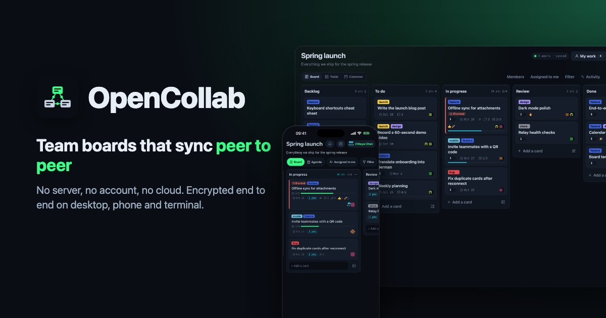

# OpenCollab

Private team boards that sync peer to peer. Post ideas, attach images, comment and vote
from the desktop app, the iPhone app or the terminal. There is no server, no account
and no cloud database: devices talk to each other directly.

## Why peer to peer

- **No backend to run or pay for.** Devices sync with each other, so hosting costs don't
  grow with users. The only optional piece of infrastructure is one always-on peer.
- **The data stays with the team.** Boards live on members' devices, encrypted with the
  invite secret. No vendor holds a copy, and a peer that stores the data cannot read it.
- **No sign-up.** Your identity is a key on your device, backed up as a recovery phrase.
  A teammate joins with an invite link.
- **Updates without a release server.** Desktop and CLI download new versions from
  peers. The iOS app picks up JavaScript updates the same way; native changes still go
  through the App Store.
- **Offline friendly.** Changes made offline sync the next time two members meet.

It suits teams that want internal tools without SaaS lock-in, privacy-sensitive groups,
and ad-hoc collaboration at events or on a shared network.

The trade-off: with no server holding a copy, two peers have to be online together to
sync. Run a [blind peer](apps/blind-peer/README.md) on a small server to cover the gaps: it
keeps an encrypted copy of your boards online without being able to read them.

How can this work with no server at all? See the [FAQ](docs/faq.md).

## Board types

Every board has a type, picked when it is created; its owner can change it later.

| Type           | Looks like                                                   | Good for                             |
| -------------- | ------------------------------------------------------------ | ------------------------------------ |
| **Kanban**     | Columns with checklists, due dates, people, estimates, rules | Team work in progress                |
| **To-do list** | One list with checkboxes; done items fold away               | Chores, shopping, personal lists     |
| **Feed**       | Posts newest first, with photos or generated covers          | Family or team news, links           |
| **Recipes**    | Sections (Breakfast, Lunch, Dinner, Desserts) of photo cards | Recipes saved from TikTok or the web |

A type only changes what the board shows: every board stores the same cards, sections,
images and comments, so switching type hides details instead of deleting them. Cards
shared from another app keep their link as **View original**. Types are defined once in
[`packages/board-protocol/kinds.js`](packages/board-protocol/kinds.js) for every client.

## Clients

All of them run the same P2P backend, [`workers/main.js`](workers/main.js), on Bare. The
UI only sends commands to it and renders what it reports back.

| Client       | Code                                    | Run                                              |
| ------------ | --------------------------------------- | ------------------------------------------------ |
| Desktop      | `electron/`, `renderer/`                | `npm start`                                      |
| iOS          | [`apps/mobile/`](apps/mobile/README.md) | `npm run --workspace @opencollab/mobile ios`     |
| Android      | [`apps/mobile/`](apps/mobile/README.md) | `npm run --workspace @opencollab/mobile android` |
| Command line | [`apps/cli/`](apps/cli/README.md)       | `npm run cli -- --help`                          |

## What's in the repo

An npm workspaces monorepo. The desktop app sits at the root; `apps/mobile`, `apps/cli`
and `packages/*` are workspaces, and the blind peer and landing page stand alone.

| Path                                                         | What it is                                                                                                                            |
| ------------------------------------------------------------ | ------------------------------------------------------------------------------------------------------------------------------------- |
| [`workers/`](workers/main.js)                                | The shared P2P backend on Bare: boards, sync, attachments, alerts, rules. Every client runs it                                        |
| [`packages/board-protocol/`](packages/board-protocol/)       | `@opencollab/board-protocol`: signed ops, the board reducer that every device converges on, activity and stats, and the message names |
| `electron/`, `renderer/`                                     | Desktop app: Electron main process and the plain-JS UI (board, table, calendar)                                                       |
| [`apps/mobile/`](apps/mobile/README.md)                      | `@opencollab/mobile`: the iOS app (React Native and Expo), with the backend bundled by `bare-pack`                                    |
| [`apps/cli/`](apps/cli/README.md)                            | `@opencollab/cli`: command-line client and always-on board peer                                                                       |
| [`apps/blind-peer/`](apps/blind-peer/README.md)              | `@opencollab/blind-peer`: keeps encrypted boards available while everyone is offline, without reading them                            |
| [`apps/landing/`](apps/landing/index.html)                   | Static website, plus the [design system](apps/landing/design-system.html) page                                                        |
| `build/`, `flatpak/`, `forge.config.js`                      | Icons, MSIX assets and packaging config for macOS, Windows and Linux                                                                  |
| `scripts/`                                                   | Tests (`npm run test:kanban` and others), the board relay, and the design-system CSS sync                                             |
| [`docs/`](docs/development.md), [`agent_docs/`](agent_docs/) | Development and deployment guides, FAQ, plans, and notes for coding agents                                                            |

## Stack

Built on [Holepunch](https://holepunch.to)'s peer-to-peer building blocks, starting
from the Pear template for Electron.

| Layer                                                                                                                  | Used for                                                    |
| ---------------------------------------------------------------------------------------------------------------------- | ----------------------------------------------------------- |
| [Pear](https://docs.pears.com)                                                                                         | P2P app delivery and OTA updates                            |
| [pear-runtime](https://github.com/holepunchto/pear-runtime), [pear-mobile](https://github.com/holepunchto/pear-mobile) | Embedding Pear updates in the Electron, CLI and iOS apps    |
| [Bare](https://github.com/holepunchto/bare)                                                                            | JavaScript runtime for the shared backend                   |
| [react-native-bare-kit](https://github.com/holepunchto/react-native-bare-kit)                                          | Runs the Bare backend inside the iOS app                    |
| [Hyperswarm](https://github.com/holepunchto/hyperswarm) / [HyperDHT](https://github.com/holepunchto/hyperdht)          | Peer discovery and hole-punched, encrypted connections      |
| [Hypercore](https://github.com/holepunchto/hypercore) / [Corestore](https://github.com/holepunchto/corestore)          | Signed append-only logs stored on each device               |
| [Autobee](https://github.com/holepunchto/autobee)                                                                      | Multi-writer board: one log per member merged into one view |
| [Hyperblobs](https://github.com/holepunchto/hyperblobs)                                                                | Encrypted image attachments                                 |
| [Hyperdrive](https://github.com/holepunchto/hyperdrive)                                                                | P2P file system that carries app releases                   |
| [Electron](https://www.electronjs.org), [Expo](https://expo.dev) / [React Native](https://reactnative.dev)             | Desktop and iOS shells                                      |

## Install with Pear

The desktop app and the CLI are published on Pear links, so you install them from peers
instead of a download server. You need [Node.js](https://nodejs.org); `npx pear` runs
the [Pear CLI](https://docs.pears.com).

```sh
# Desktop app, installed into your OS applications folder
npx pear install pear://nzi3suuxyzwj6oosortonj5pxd9s7ckgd8cr87szddaamxi77kny

# CLI, then put it on your PATH
npx pear install --to ~/.local/share pear://q1huw5ozxk8j36pcb8sicfr4dtgf9154r5aj3yzqa14ngxxq1kmy
ln -s ~/.local/share/opencollab/bin.js /usr/local/bin/opencollab
```

Installed apps update themselves from the same link. Installs and updates need at least
one peer online that has the release, such as a machine running `pear seed <link>`.
Builds are published per platform, so a platform without a published build can't install.

The phone apps can't be installed from Pear. For Android (10 or newer, 64-bit ARM),
download the APK from the
[Android releases](https://github.com/Chmarusso/p2p-collab-board/releases?q=android-v&expanded=true);
install a newer APK over it to update. For iOS, build it from
[`apps/mobile`](apps/mobile/README.md); after that it receives JavaScript updates over Pear.

## Connect your AI

Any AI that speaks the [Model Context Protocol](https://modelcontextprotocol.io) (Claude
Code, Claude Desktop, Codex, Cursor, ChatGPT, your own agent) can join a board as a
teammate: it reads cards, comments, moves work and answers `@mentions`. There is no
service to sign up for. The CLI's `opencollab mcp` runs the board on your machine and
serves it to the AI.

```sh
export OPENCOLLAB_PASSWORD=…                  # password for the AI's own identity
opencollab identity new -s ~/.opencollab-ai
opencollab join '<invite link>' -s ~/.opencollab-ai
opencollab name Claude -s ~/.opencollab-ai
claude mcp add opencollab -s user -e OPENCOLLAB_PASSWORD="$OPENCOLLAB_PASSWORD" \
  -- opencollab mcp -s ~/.opencollab-ai
```

The AI appears under Members, and removing it there cuts it off. `--read-only` limits it
to reading. Other clients, HTTP for remote agents, and the tool list:
[CLI README](apps/cli/README.md#ai-clients-mcp). Coding agents can set it up themselves
with the [`opencollab-mcp` skill](.claude/skills/opencollab-mcp/SKILL.md), or drive the
CLI directly with the [`opencollab-cli` skill](.claude/skills/opencollab-cli/SKILL.md).

## Run from source

```sh
npm run install:mac   # macOS (npm run install:all on Windows and Linux)
npm start             # desktop app in dev mode
```

## More

- [Development and deployment](docs/development.md): architecture and OTA diagrams,
  storage, releases, store submissions, developer FAQ and troubleshooting
- [FAQ](docs/faq.md): how OpenCollab works without servers
- [Blind peer](apps/blind-peer/README.md): keep boards available while everyone is offline
- [Running on a server](docs/server.md): the CLI on a VPS, bots, automations and MCP over HTTP
- [Landing page](apps/landing/index.html): static site explaining the app, no build step
- [Design system](apps/landing/design-system.html): brand, tokens and every website and app
  component on one page. After changing desktop styles, run
  `node scripts/sync-design-system.mjs` to refresh the app components' CSS
- [Pear documentation](https://docs.pears.com)
